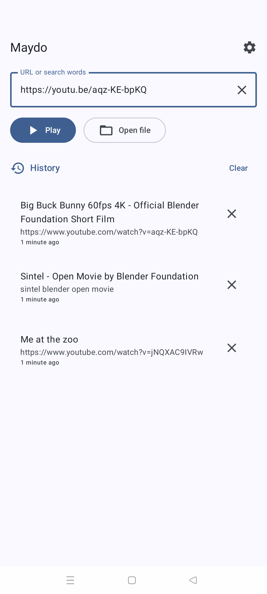
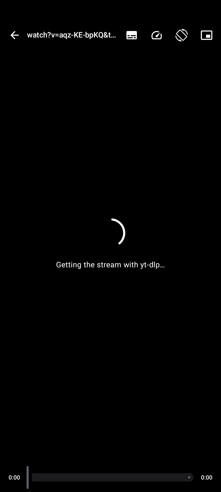
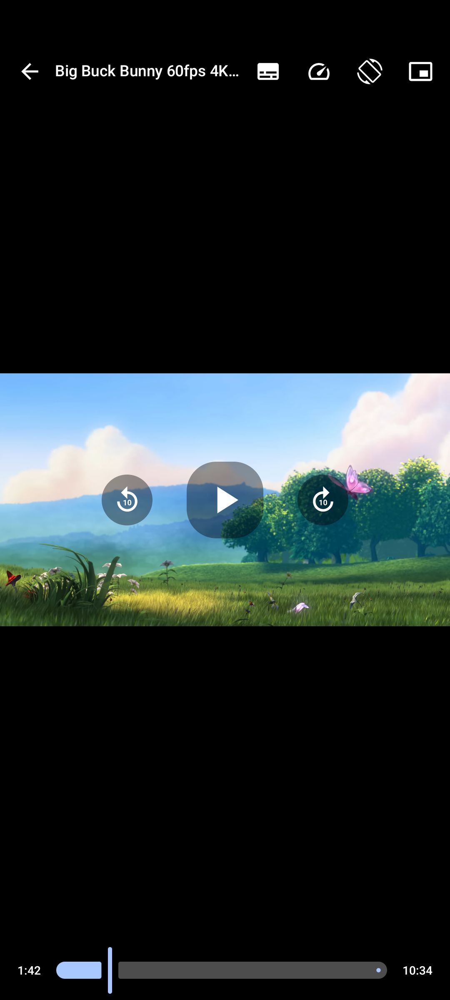
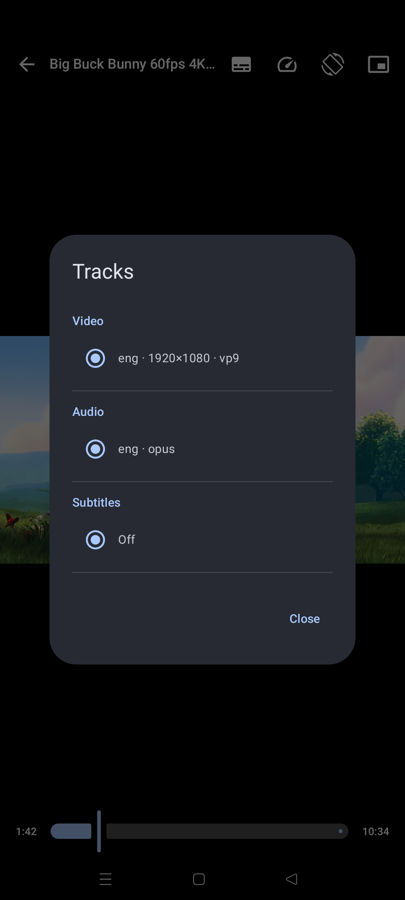
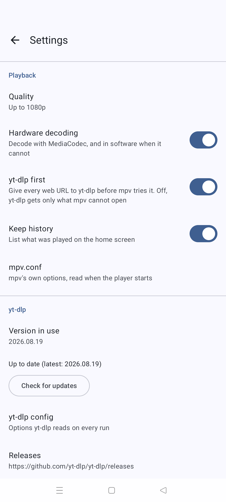
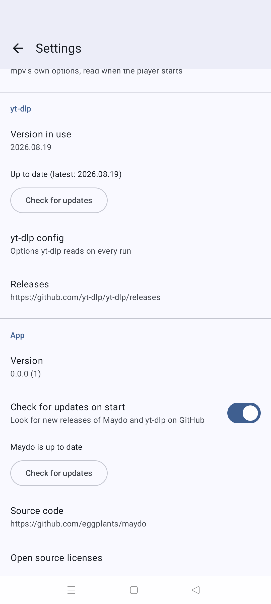

#  <ins>Maydo</ins>

[![ci][ci-badge]][ci] [![release][release-badge]][release] [![GitHub Release][gh-release-badge]][gh-release]

[ci-badge]: <https://github.com/eggplants/maydo/actions/workflows/ci.yml/badge.svg>
[ci]: <https://github.com/eggplants/maydo/actions/workflows/ci.yml>
[release-badge]: <https://github.com/eggplants/maydo/actions/workflows/release.yml/badge.svg>
[release]: <https://github.com/eggplants/maydo/actions/workflows/release.yml>
[gh-release-badge]: <https://img.shields.io/github/v/release/eggplants/maydo?color=white>
[gh-release]: <https://github.com/eggplants/maydo/releases/latest>

An Android video player built on [mpv] with [yt-dlp] inside: open a file, or give it the URL of a
web page, and yt-dlp finds the stream that mpv plays.

[mpv]: <https://mpv.io/>
[yt-dlp]: <https://github.com/yt-dlp/yt-dlp>

<p>
  
  
  
  
  
  
</p>

<sub>The video is [Big Buck Bunny](https://peach.blender.org/) (CC BY 3.0, Blender Foundation).</sub>

## Features

- **Play anything mpv or yt-dlp can open**: paste a URL, type search words (yt-dlp plays the
  first YouTube result), share a link from a browser or any other app, or open a local file.
- **Playlists**, as in mpv on a desktop:
  - `.m3u` / `.m3u8` files (local files, streams and web pages in them), and HLS streams.
  - Playlists on video sites, through yt-dlp: a playlist link plays all of it, and a video link
    with a playlist in it (`watch?v=…&list=…`) plays the playlist from that video (can be
    turned off).
  - A folder picked with the system's folder picker: its video and audio files and those of its
    subfolders, in natural order (`2` before `10`).
  - Previous / next, and the list of the playlist to jump anywhere in it.
- **Player**: quality limit, hardware decoding, video, audio and subtitle tracks, playback
  speed, picture-in-picture.
  - Swipe across to seek, up and down on the left half for brightness and on the right half
    for volume; double-tap the sides to skip 10 seconds, the middle to pause.
- `mpv.conf` and yt-dlp's config file can be edited in the app.
- History, English and Japanese UI, dynamic color.

## Development

[mise](https://mise.jdx.dev/) and the Android SDK with NDK r28c
(`sdkmanager "ndk;28.2.13676358"`) required.

```bash
# first
mise install
mise generate git-pre-commit -w

mise run build
mise run test
mise run lint
mise run format
```

## Build for distribution

```bash
# 1. Create the key (PKCS12, so the key password is the keystore password):
keytool -genkeypair -keystore release.jks -alias maydo -keyalg RSA -keysize 4096 -validity 36500

# 2. Fill in MAYDO_KEYSTORE_BASE64 and MAYDO_KEY_ALIAS:
cp .env.example .env
{
  echo "MAYDO_KEYSTORE_BASE64=$(base64 -w0 release.jks)"
  echo "MAYDO_KEY_ALIAS=maydo"
} >> .env

# 3. Add the two same passwords by hand: MAYDO_KEYSTORE_PASSWORD / MAYDO_KEY_PASSWORD
$EDITOR .env

# 4. Send everything to the repository's Actions secrets, and check it:
gh secret set --env-file .env
gh secret list

# 5. Test in local
mise run build:release

# 6. Tag: v<versionName>-<versionCode>, with a higher versionCode every time
git tag vX.Y.Z-N -m ... && git push origin vX.Y.Z-N
```

The release workflow attaches `maydo-<version>-<abi>.apk` for each ABI and a universal one; the
in-app updater picks the one for the device's ABI by that name.

## License

[MIT](LICENSE)

`app/src/main/assets/ytdl_hook.lua` is a modified copy of mpv's
[ytdl_hook.lua](https://github.com/mpv-player/mpv/blob/master/player/lua/ytdl_hook.lua), under
mpv's LGPL-2.1-or-later.
